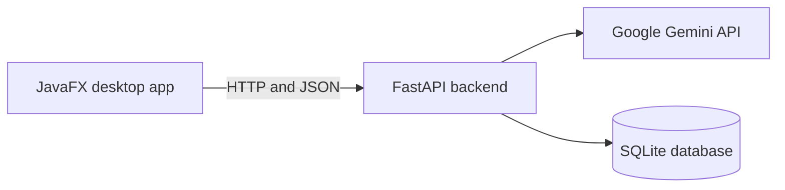

<p align="center">

</p>

<div align="center">

[](https://www.java.com/)
[](https://openjfx.io/)
[](https://www.python.org/)
[](https://fastapi.tiangolo.com/)
[](https://deepmind.google/technologies/gemini/)
[](https://www.sqlite.org/)

**Describe a piece of clothing and get a complete outfit idea in seconds.**

</div>

VirtualCloset is an AI wardrobe assistant with a JavaFX desktop app and a FastAPI backend powered by Google Gemini. Our team of four built it at HackCOMS 2025 to take some of the effort out of deciding what to wear.


## Why we built it

Most people own plenty of clothes but still struggle to put outfits together, especially when they're short on time. We wanted to see whether AI could turn a simple description like "I have a red floral skirt" into advice someone could use right away.

## What it does

**In the desktop app**
- **Outfit ideas:** describe an item and get an outfit suggestion, an accessorizing tip and an occasion to wear it.

**Through the REST API**
- **Closet management:** create, list, update and delete garments, stored in SQLite.
- **Garment parsing:** turn free-form text into structured data using Gemini's JSON output mode.
- **Outfit pairing:** select garments from the closet and get a styled combination with the reasoning behind it.

The closet, parsing and pairing features aren't connected to the desktop app yet. See [Current status](#current-status) for details.

## How it works



The backend keeps its routes, data access and Gemini integration in separate modules, and the API key stays on the server side.

| Layer | Technology |
|---|---|
| Desktop app | Java, JavaFX, FXML, Gson, Maven |
| Backend | Python, FastAPI, Uvicorn, Pydantic |
| AI | Google Gemini through the `google-genai` SDK |
| Data | SQLite, SQLAlchemy, pandas |
| Testing | pytest with mocked Gemini and database calls |

## API

Interactive documentation is available at `http://127.0.0.1:8000/docs` while the backend is running.

| Method | Endpoint | Purpose |
|---|---|---|
| `POST` | `/api/outfits/find-ideas` | Generate an outfit idea from a description |
| `POST` | `/api/outfits/analyze` | Parse a description into name, category and color |
| `POST` | `/api/outfits/generate` | Suggest an outfit from selected garment IDs |
| `GET` | `/api/garments/` | List all garments |
| `POST` | `/api/garments/` | Add a garment |
| `PUT` | `/api/garments/{garment_id}` | Update a garment |
| `DELETE` | `/api/garments/{garment_id}` | Delete a garment |

**Example request**

```bash
curl -X POST http://127.0.0.1:8000/api/outfits/analyze \
  -H "Content-Type: application/json" \
  -d '{"userId": "demo", "text": "I have a red floral skirt"}'
```

**Example response**

```json
{
  "userId": "demo",
  "parsed": {
    "name": "Red floral skirt",
    "category": "Skirt",
    "color": "Red"
  }
}
```

Gemini generates the response, so the exact wording can vary.

## Getting started

### Prerequisites

- Python 3.12
- JDK 11 or newer
- Maven
- A [Google Gemini API key](https://aistudio.google.com/apikey)

We've run the project on Windows with Python 3.12 and JDK 25.

### 1. Start the backend

```bash
cd clothe-ai-backend
python -m venv .venv

# Windows PowerShell
.\.venv\Scripts\Activate.ps1
# macOS or Linux
source .venv/bin/activate

pip install -r requirements.txt
```

Create a file named `.env` in `clothe-ai-backend/`:

```text
GEMINI_API_KEY=your-api-key
```

The `.env` file is already listed in `.gitignore`, so it won't be committed. Then start the server:

```bash
uvicorn main:app --reload
```

The SQLite database is created automatically the first time the backend starts.

### 2. Start the desktop app

In a second terminal, from the repository root:

```bash
cd clothe-ai-frontend/main_page
mvn clean javafx:run
```

## Running the tests

```bash
cd clothe-ai-backend
pytest tests
```

The tests mock Gemini, so they don't need an API key or make any real AI calls.

## Current status

VirtualCloset is a working hackathon MVP.

| Feature | Backend API | Desktop app |
|---|---|---|
| Outfit ideas | Working | Working |
| Garment management | Working | Placeholder closet screen |
| Garment parsing | Working | Not connected |
| Outfit pairing | Working | Not connected |
| User accounts | Not built | Placeholder login screen |

## Roadmap

- [ ] Connect the closet screen to the garment API
- [ ] Add garment parsing and outfit pairing to the desktop app
- [ ] Add real user accounts with a separate closet for each user
- [ ] Show a clear message when the AI service is busy

## Project structure

```text
.
├── clothe-ai-backend/
│   ├── main.py                  # FastAPI application
│   ├── models/garment.py        # SQLite data access
│   ├── routes/                  # Garment and outfit endpoints
│   ├── services/gemini_service.py
│   └── tests/
└── clothe-ai-frontend/main_page/
    ├── pom.xml
    └── src/main/                # JavaFX controllers and FXML screens
```

## Team

Built at HackCOMS 2025 by:

- Aparnaa Senthilnathan
- Emma Zheng
- Wendy Wang
- [ib9168](https://github.com/ib9168)

## License

Released under the [MIT License](LICENSE).
